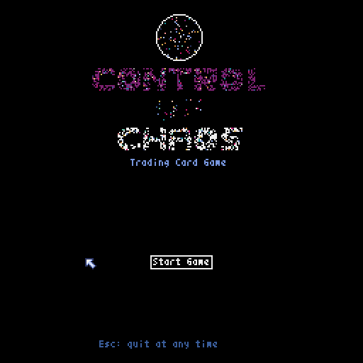
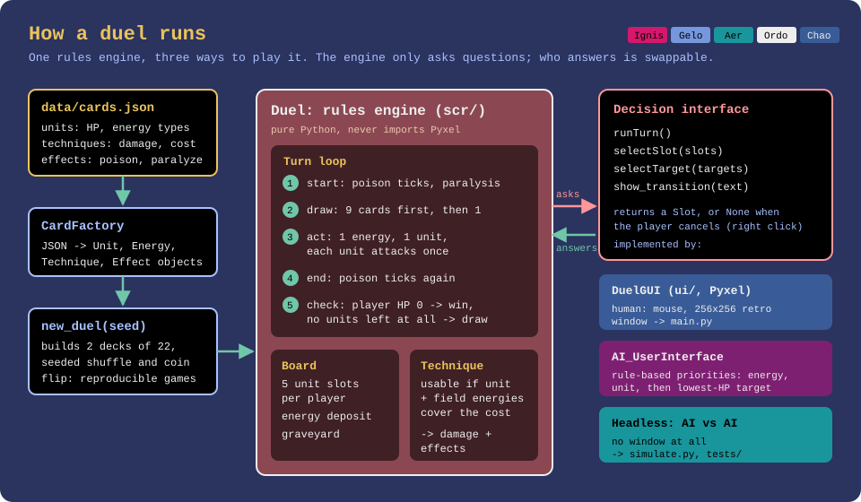

# Control of Chaos: Trading Card Game

**A retro trading card game in Python and [Pyxel](https://github.com/kitao/pyxel). Its rules engine runs the same game in a window, against an AI, or headless for thousands of simulated duels.**



<sub>A real session recorded from the game (seed 19, 45 s at real speed). I play a unit, attach two Chao energies and hit the AI's unit with *Poison Sting*. The mouse input comes from [`tools/record_demo.py`](tools/record_demo.py), which reads the live game state and clicks through X11 the way a player would.</sub>

## What it is

Control of Chaos is a two-player card duel. You deploy **units**, power them with **energies** of five types (Ignis, Gelo, Aer, Ordo, Chao) and use their **techniques** to wear down the opposing units and then the opponent's 20 life points. It runs in a 256×256 pixel-art window with a mouse-driven UI: a hand you can fan through, card inspection, highlighted targets, scrolling announcements and an animated "chaos" logo on the title screen.

I built it around two ideas:

- **The rules engine knows nothing about the screen.** `scr/` is plain Python. When the engine needs a decision ("which slot?", "which target?", "play your turn"), it asks an interface object. The Pyxel GUI, the AI and a headless runner all implement that same interface, so the same code drives a human game, a game against the AI, or 1,000 AI-vs-AI games in about a second.
- **The GUI answers questions as blocking calls.** When the engine asks for a target, the GUI runs its own frame loop until the player clicks (or right-clicks to cancel) and then returns the answer. Game logic like `target = duel.selectTarget(options)` stays sequential code, with no state machine or callbacks.

## Features

- Full duel against a rule-based AI: draw, energies, units, techniques, status effects, win/draw detection
- Data-driven cards: units, techniques and effects live in [`data/cards.json`](data/cards.json) and are built by a `CardFactory`
- Status effects: **poison** (1 damage at the start and end of its owner's turn) and **paralysis** (can't attack on its next turn; implemented, but no current card uses it yet)
- Title screen, turn announcements, a victory/defeat screen, right click to cancel any target selection
- Reproducible games: `--seed` fixes the deck shuffles and the coin flip for who goes first
- Hot-seat mode for two people on one computer
- Headless balance simulator and a pytest suite for the rules

## Quick start

Requires Python 3.11+ (Pyxel 2's minimum).

```bash
git clone https://github.com/crisdesivo/Control-of-chaos-TCG.git
cd Control-of-chaos-TCG
pip install -r requirements.txt
python main.py
```

| Option | What it does |
|---|---|
| `--seed 7` | Same shuffles and first player every time |
| `--hot-seat` | Two humans instead of you vs the AI |
| `--skip-menu` | Go straight to the duel |

**Controls:** click a card in your hand to inspect it, then **Play card**. Click one of your units on the board to use a technique. Click the highlighted slot to choose a target, or **right click** to cancel. Click **Next Turn** to pass. **Esc** quits.

## Rules (as implemented)

- Each deck has 22 cards: 2 units + 4 of each energy type. Both players start at **20 HP**.
- The first turn draws 9 cards. After that, one card per turn.
- On your turn you may play **one energy** (attach it to one of your units or to your field deposit) and **one unit** (up to 5 on the board).
- Each unit can use **one technique per turn** when the energies attached to it plus your field energies cover the technique's cost.
- A technique hits an enemy unit of your choice. If the opponent has no units, it hits the opponent directly.
- Defeated units go to the graveyard together with their attached energies.
- You **win** when the opponent reaches 0 HP. The game is a **draw** when no units remain anywhere (board, hands or decks).

The current card pool is small: two units (*Unidad 1*, 3 HP; *Unidad 2*, 6 HP), both with *Poison Sting* (1 damage, costs 2 Chao, poisons the target).

## Balance simulator

Since the engine runs without a window, I can measure the game instead of guessing:

```console
$ python simulate.py --games 1000 --seed 0
Duels simulated           1000
Player 1 (U01 deck) wins    310   31.0%
Player 2 (U02 deck) wins    470   47.0%
Draws                       220   22.0%  (turn limit: 101)
First player wins           416   53.3% of decided duels
Turns per decided duel    mean 59.6, median 59, min 45, max 82
```

This output already shows two things. The 6-HP unit's deck wins clearly more often. And about 10% of games stall: units are still on the board, but none of them can reach the 2 Chao energies *Poison Sting* needs (the rest are in the graveyard or attached to other units), so nobody can attack again. I checked all 101 games that hit the 500-turn limit and every one is this case. Rules work like a new card or energy recycling can be checked against these numbers.

## How it works



1. `CardFactory` turns `data/cards.json` into `Unit`, `Energy`, `Technique` and `Effect` objects. Effects are looked up by name (`"poison"`, `"paralyze"`), so a new card is a JSON entry.
2. `new_duel(seed)` builds and shuffles both decks with one seeded `random.Random`, so a seed always gives the same game.
3. `Duel.begin()` runs the turn loop. For every decision it calls `selectSlot`, `selectTarget` or `runTurn` on whichever interface controls the current player:
   - `DuelGUI` (Pyxel): the board, hand, card display and transition components draw themselves and resolve mouse input.
   - `AI_UserInterface`: plays an energy (onto its toughest unit), then a unit, then the first affordable technique on the lowest-HP enemy.
   - With no GUI at all, both players are the AI. `simulate.py` and the tests use this mode.

## Project structure

```
main.py                 entry point: title screen -> duel -> result screen
simulate.py             headless AI-vs-AI balance simulator
data/cards.json         card database (units, techniques, effects, energies)
scr/                    rules engine, pure Python
  duel.py               turn loop, win/draw detection, who decides what
  turn.py               per-turn limits and attack resolution
  card.py               Card, Energy, Unit (status effects, death)
  technique.py          costs and effects of attacks
  card_factory.py       JSON -> card objects
  game_setup.py         decks, seeded shuffles, new_duel()
  ai_user_interface.py  rule-based AI
  board.py, slot.py, hand.py, deck.py, graveyard.py, energy_deposit.py, player.py
ui/                     Pyxel front end
  duel_gui.py           the human "decision interface"
  board_gui.py, hand_gui.py, card_display.py, transitions.py, main_menu.py
  primitives.py         drawing helpers (cards, HP pips, chaos logo)
  assets/               sprites (.pyxres) and tileset
tests/test_rules.py     rules tests (no window needed)
tools/record_demo.py    records assets/demo.gif from a real session
```

## Development

```bash
pip install -r requirements-dev.txt
pytest                  # 10 rules tests, under a second
python simulate.py      # balance report
```

To re-record the demo GIF (Linux, needs Xvfb and ffmpeg):

```bash
xvfb-run -s "-screen 0 1024x768x24" python tools/record_demo.py
```

## Status

Playable prototype: complete GUI duel against a simple AI.

Next ideas: let players order their own deck (the original design aims for no luck-based mechanics), more units and techniques, rules that fix the stalls found by the simulator, a smarter AI, and network multiplayer.

## Built with

- [Pyxel](https://github.com/kitao/pyxel), a retro game engine for Python

## Contributing

See [CONTRIBUTING.md](CONTRIBUTING.md).

## License

GNU General Public License v3.0. See [LICENSE.txt](LICENSE.txt).

---

Made by Cristian Desivo — https://cristiandesivo.com
